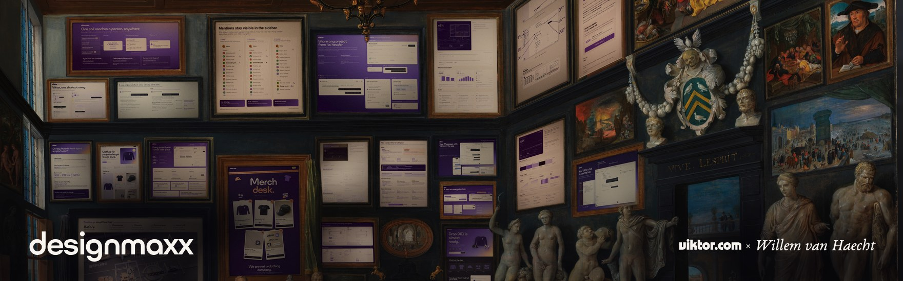
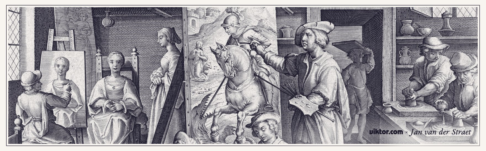
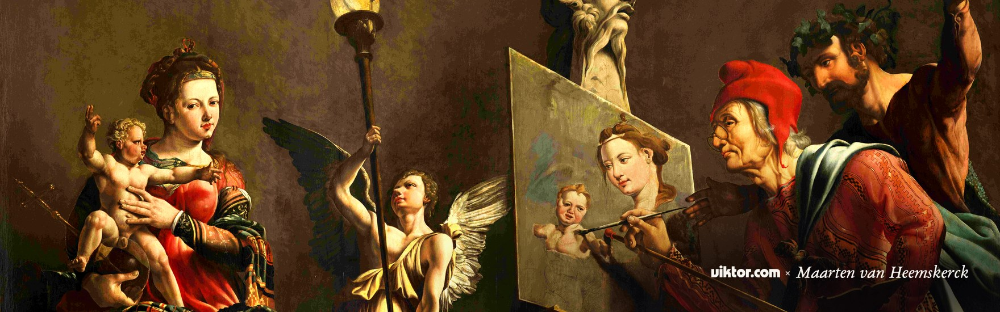

<p align="center">
  <br>
  <sub><i>The Gallery of Cornelis van der Geest</i>, Willem van Haecht, 1628<br>Some of the frames now hold work our agents made.</sub>
</p>

This is how we design with coding agents, bottled up as skills. Install them and
your agent picks up your team's taste: it tries a few directions before settling
on one, checks its own work like a fussy designer would, and shows you what
changed in a picture instead of a paragraph.

```bash
npx skills add viktor-com/agentic-design
```

## Skills

- **brand**: writes the project's `DESIGN.md`, the one file every visual task reads first.
- **building-blocks**: makes the agent use the team's real components and tokens instead of inventing new ones.
- **design-review**: reviews built UI like a picky designer before anyone sees it: every state, measured alignment, copy, clicks.
- **infographic**: makes a one-frame graphic for a PR, a launch or a result, with real UI and numbers against a named baseline.
- **prototype-ui**: runs a prototype lab, a few clickable variants next to today's UI, picked and iterated over rounds.
- **visualize-ui**: turns UI changes, data and flows into annotated stills, slowed clips, infographics and explainer pages.

<p align="center">
  <br>
  <sub><i>Color Olivi (Nova Reperta)</i>, Jan Collaert II after Jan van der Straet, c. 1590<br>Each person in the workshop has one job, the way each agent in a lab builds one variant.</sub>
</p>

## Example

Set up once per repo:

```
> Set up our DESIGN.md
```

That writes `DESIGN.md` and adds the design rules to `AGENTS.md` (and `CLAUDE.md`) and
to the PR template, so every agent follows them on every task. Then just build:

```
> The settings page feels cluttered. Fix it.
```

The agent builds a few variants next to today's UI, posts the lab with its pick and
the reason, and keeps going without waiting. It reviews the result, then opens the
PR with an annotated before/after. Reply with a label ("B, but with C's header") at
any point to switch.

None of this is our brand. Your colours, fonts and voice come from your own
`DESIGN.md`.

<p align="center">
  <br>
  <sub><i>St Luke Painting the Virgin</i>, Maarten van Heemskerck, 1532<br>The painter checks the canvas against his sitter, as design review checks the build against the design.</sub>
</p>

## License

MIT. The paintings are public domain.
